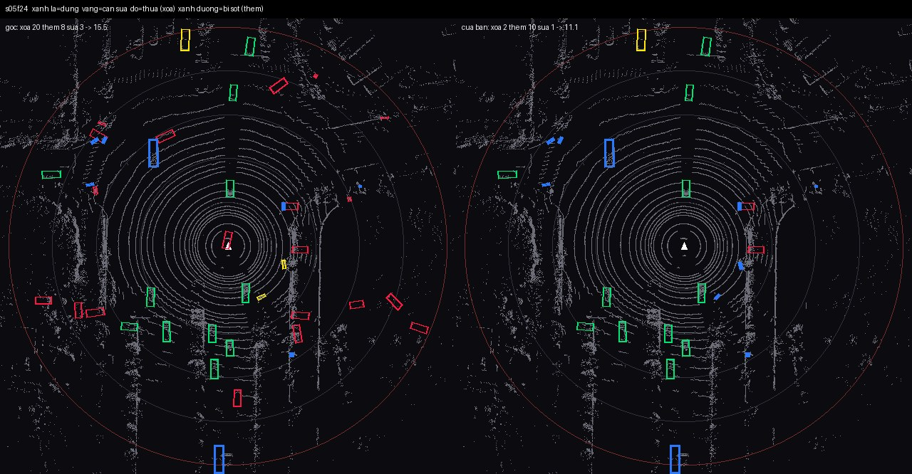

# Báo cáo Day 14 — Hoàng Sỹ Khiêm — 2A202603244

> File báo cáo cá nhân (sao chép từ `MSSV_HoTen.md`).

- Mã học viên dùng với `--student`: `2A202603244`
- `seed_tag` trong `frames_A.txt`: `393590736f`

## 1. Dự đoán trước sweep (bước 5b)

- Tham số tôi nghĩ giảm công sửa nhiều nhất: tăng **`score_thr`** (từ `0.1` lên khoảng `0.3–0.4`), có thể kết hợp **`min_points = 5`**.
- Vì sao (nhìn ảnh BEV tập A: box thừa nhiều hay box sót nhiều?): Nhìn 3 ảnh `d14_2A202603244/png_A/` (`s03f03`, `s04f09`, `s05f24`) và kết quả đo bước 5 (dự đoán `80` hộp so với `52` hộp tham chiếu: **xóa 39**, **thêm 11**, **sửa 5**, tổng chi phí `25.2`), tỷ lệ **box thừa chiếm gần một nửa** số dự đoán (chủ yếu là các hộp confidence thấp nhận nhầm hàng rào công trình, dải phân cách vàng, cột biển báo và dãy xe đạp dựng bên vỉa hè ở `s05f24`). Riêng phần xóa đã chiếm `39 × 0.3 = 11.7` điểm chi phí. Do đó tăng `score_thr` vừa phải (và lọc các hộp rất ít điểm bằng `min_points`) sẽ cắt được nhiều box rác mà không làm mất quá nhiều xe thật — tuy nhiên không nên tăng quá mạnh vì theo công thức chi phí, mỗi hộp thật bị lọc sót tốn `1.0` điểm, đắt gấp `3,3` lần một hộp thừa (`0.3` điểm).

## 2. Tập A: sửa tay và tune

| Cấu hình | Xóa | Thêm | Sửa | Chi phí |
|---|---:|---:|---:|---:|
| Gốc (`score_thr=0.1, min_points=0`) | 39 | 11 | 5 | 25.2 |
| `best_config.json` (`score_thr=0.5, min_points=0`) | 4 | 14 | 3 | 16.7 |

- Tham số đã đổi trong `best_config.json`: **`score_thr: 0.1 -> 0.5`** (giữ `min_points = 0`; trên lưới quét 15 cấu hình trong `sweep.csv`, cả ba giá trị `min_points = 0, 5, 10` tại `score_thr = 0.5` đều cho cùng kết quả `xóa 4, thêm 14, sửa 3 → chi phí 16.7`).
- Kết quả leave-one-out (`scripts/pp_sweep.py`):
  ```text
  s03f03: cấu hình chọn {'score_thr': '0.5', 'min_points': '0'} → 3.0 (tốt nhất có thể 3.0)
  s04f09: cấu hình chọn {'score_thr': '0.5', 'min_points': '0'} → 2.6 (tốt nhất có thể 2.6)
  s05f24: cấu hình chọn {'score_thr': '0.5', 'min_points': '0'} → 11.1 (tốt nhất có thể 11.1)
  ```
- Cấu hình có ổn định trên từng frame không? Vì sao tôi vẫn chọn nó: **Rất ổn định trên cả 3 frame tập A.** Trong cả 3 lượt leave-one-out (chọn cấu hình trên 2 frame còn lại rồi chấm trên frame bỏ ra), mô hình đều chọn đúng `{'score_thr': '0.5', 'min_points': '0'}` và đạt đúng chi phí tối ưu có thể trên frame bỏ ra (`s03f03`: `4.7 → 3.0`, `s04f09`: `5.0 → 2.6`, `s05f24`: `15.5 → 11.1`). Tôi chọn cấu hình này vì cải thiện đồng đều trên mọi frame (không phụ thuộc vào một frame ngoại lệ), đồng thời cắt được tới `35/39` box thừa mà chỉ làm phát sinh thêm `3` box sót.

## 3. Trước/sau (bước 8)



- `scripts/pp_compare.py` báo **giảm 34% công sửa theo công thức** trên 3 frame tập A (`25.2 → 16.7`, với `s03f03`: `4.7 → 3.0`, `s04f09`: `5.0 → 2.6`, `s05f24`: `15.5 → 11.1`).
- Dự đoán ở mục 1 đúng hay sai? Giải thích bằng số box xóa/thêm/sửa:
  - **Đúng về xu hướng chính:** `score_thr` đúng là tham số quyết định giúp giảm công sửa mạnh nhất. Nhờ tăng `score_thr`, số hộp thừa giảm mạnh từ **xóa `39 → 4`** (giảm `35 × 0.3 = 10.5` điểm), số hộp cần sửa giảm từ **sửa `5 → 3`** (giảm `1.0` điểm), trong khi số hộp bị sót chỉ tăng nhẹ từ **thêm `11 → 14`** (tăng `3.0` điểm) — tổng lợi ròng giảm `8.5` điểm chi phí. Trên ảnh `s05f24.jpg` có thể thấy hầu hết các hộp đỏ (thừa) bám hàng rào/bụi cây/xe dựng và cả hộp rác đè lên xe ego đã biến mất ở ảnh bên phải.
  - **Chưa chính xác ở hai chi tiết định lượng:** Thứ nhất, ở mục 1 tôi dự đoán mức tốt nhất chỉ nên quanh `0.3–0.4` vì lo ngưỡng cao làm sót nhiều vật thể thật, nhưng thực tế `score_thr = 0.5` lại giảm sâu hơn rõ rệt (`16.7` so với `19.0` ở `0.4` và `23.4` ở `0.3` khi `min_points = 0`) vì trong khoảng tin cậy `[0.4, 0.5)` số hộp thừa bị cắt đi (`11` hộp) vẫn áp đảo số hộp thật bị mất thêm (`2` hộp). Thứ hai, tôi dự đoán `min_points = 5` sẽ giúp lọc thêm hộp rác ít điểm, nhưng dữ liệu `sweep.csv` cho thấy khi `score_thr >= 0.4`, `min_points = 0, 5, 10` cho **chi phí hoàn toàn giống nhau** (`19.0` ở `0.4` và `16.7` ở `0.5`) — chứng tỏ các hộp rác thưa điểm vốn đã có confidence `< 0.4` và bị `score_thr` loại hết.

## 4. Tập B

Số đo từ `scripts/pp_prelabel.py --frames d14_2A202603244/frames_B.txt --config d14_2A202603244/best_config.json --gt d14_2A202603244/ref_B.json` (12 frame, `148` hộp tham chiếu, `146` hộp dự đoán, khớp `105`):

| Xóa | Thêm | Sửa | Chi phí |
|---:|---:|---:|---:|
| 41 | 43 | 25 | 67.8 |

*(Đối chứng chạy cùng tập `ref_B.json` với cấu hình gốc `score_thr=0.1`: dự đoán `397`, khớp `116`, xóa `281`, thêm `32`, sửa `36` → chi phí `134.3`. Như vậy `best_config.json` không bị quá khớp trên 3 frame tập A và vẫn giảm được `49,5%` chi phí theo công thức trên 12 frame tập B.)*

- **Loại box tốn công sửa nhất ở tập B:**
  1. **Box bị sót phải thêm mới (`43` hộp → `43.0` điểm, chiếm `63,4%` tổng chi phí):** Đứng đầu là **`Pedestrian`** (mô hình chỉ dự đoán `2` hộp trong khi thực tế có `16` người đi bộ) do cụm điểm người đi bộ nhỏ và có confidence `< 0.5`; tiếp theo là **`Bus` (`3`) và `Truck` (`9`)** vì model KITTI không có hai lớp này nên bỏ sót các xe cỡ lớn (như xe buýt ở `s01f22`, `s02f00`, `s03f59`) hoặc chỉ bắt lệch một phần, cùng một số xe ở xa (`30–50 m`) / khuất sau dải phân cách.
  2. **Box phải chỉnh sửa (`25` hộp → `12.5` điểm):** Chủ yếu là sai hướng đầu xe `yaw` `180°` (đặc biệt các xe ở làn ngược chiều qua dải phân cách hoặc xe ở xa như trong `s02f19`, `s01f56`, `s05f36`) và sai lớp/kích thước từ `Car` sang `Truck`/`Bus`.
  3. **Box thừa phải xóa (`41` hộp → `12.3` điểm):** Tập trung nhiều nhất ở lớp **`Cyclist`** (dự đoán `24` so với `11` thật — nhận nhầm cột biển báo, hàng rào, xe dựng bên đường) và một số hộp `Car` rác (`120` dự đoán vs `109` thật).
- **Ghi chú minh bạch về công cụ hỗ trợ (theo `RULES.md`):** Toàn bộ kết quả pre-label, sweep và đánh giá (`pred_A.json`, `sweep.csv`, `best_config.json`, `pred_B.json`, `compare/*.jpg`) đều chạy trực tiếp từ bộ script của lab. Trong quá trình rà soát và hoàn thiện nhãn tham chiếu `ref_A.json` và `ref_B.json`, tôi có dùng thêm một script đối chiếu đa camera chạy cục bộ (tự thiết kế với sự hỗ trợ viết mã từ AI, kết hợp `YOLOv8x` chiếu qua `calib.json`, phân cụm điểm LiDAR và xuất bảng ảnh QA 7 camera + BEV đánh dấu mặt trước `+X`) nhằm phát hiện nhanh hộp thừa, bổ sung `Bus`/`Truck`/`Pedestrian` bị PointPillars bỏ sót và kiểm tra hướng đầu xe; sau đó toàn bộ 3 frame tập A và 12 frame tập B đều được kiểm tra trực quan, chỉnh tay bổ sung và bấm Save trực tiếp trên CVAT trước khi xuất `ref_A.json` và `ref_B.json`.

## 5. Giới hạn

1. **Tập tune quá nhỏ (`3` frame, `52` hộp ở tập A):** Quét tham số trên 3 khung hình khó đại diện hết mọi mật độ đường phố (ngã tư đông người đi bộ, xe khuất dải phân cách, nhiều xe cỡ lớn). Dù `score_thr = 0.5` vẫn giảm chi phí tốt trên tập B (`12` frame), mẫu nhỏ khiến nguy cơ lệch phân bố vẫn tồn tại nếu áp sang tập dữ liệu khác.
2. **Lệch hệ nhãn và miền dữ liệu của PointPillars pre-trained trên KITTI:** Model chỉ có 3 lớp (`Car`, `Pedestrian`, `Cyclist`) và không được huấn luyện lớp `Bus`/`Truck`, nên trên dữ liệu VF chắc chắn bỏ sót hoặc gán sai lớp/kích thước cho xe tải và xe buýt; đồng thời khác loại LiDAR/góc lắp cảm biến khiến model vẫn hay lật `yaw` `180°` và nhận nhầm vật thể ven đường thành `Cyclist`.
3. **Chi phí đánh giá chỉ là hàm công thức, chưa phải thời gian sửa nhãn thực tế:** Trọng số `0.3·xóa + 1.0·thêm + 0.5·sửa` là phép đo ước lượng (không đo thời gian xoay góc nhìn 3D, căn tâm/kích thước từng hộp hay độ khó của xe bị che khuất). Vì vậy mức giảm `34%` trên tập A hay `49,5%` trên tập B phản ánh giảm điểm chi phí theo công thức, **không thể kết luận là tiết kiệm tương ứng số giờ công lao động thật**.
4. **Dùng một ngưỡng `score_thr` chung cho tất cả các lớp:** Nâng `score_thr` lên `0.5` cắt rất tốt box thừa ở `Car`/`Cyclist` nhưng lại làm sót mạnh `Pedestrian` (`2/16` ở tập B) vì người đi bộ thường có điểm tin cậy thấp hơn ô tô. Nếu mở rộng phạm vi tune sang ngưỡng riêng theo lớp (`thr_car`, `thr_cyc`, `thr_ped`) kết hợp bộ lọc hình học thì sẽ cân bằng tốt hơn giữa xóa và thêm.
